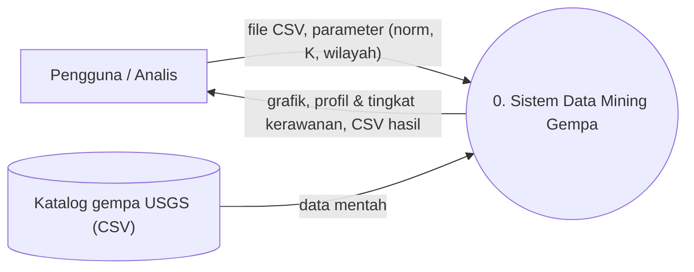
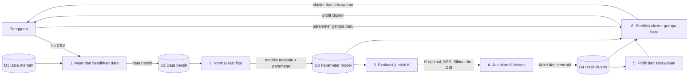
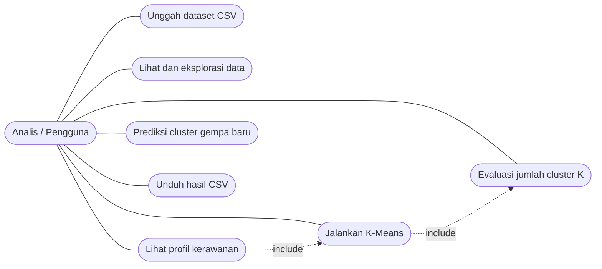
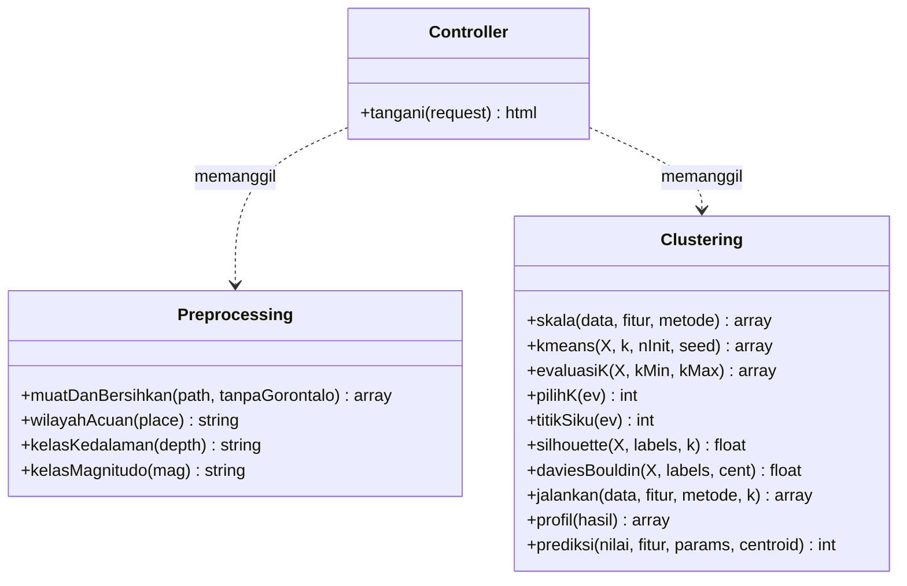
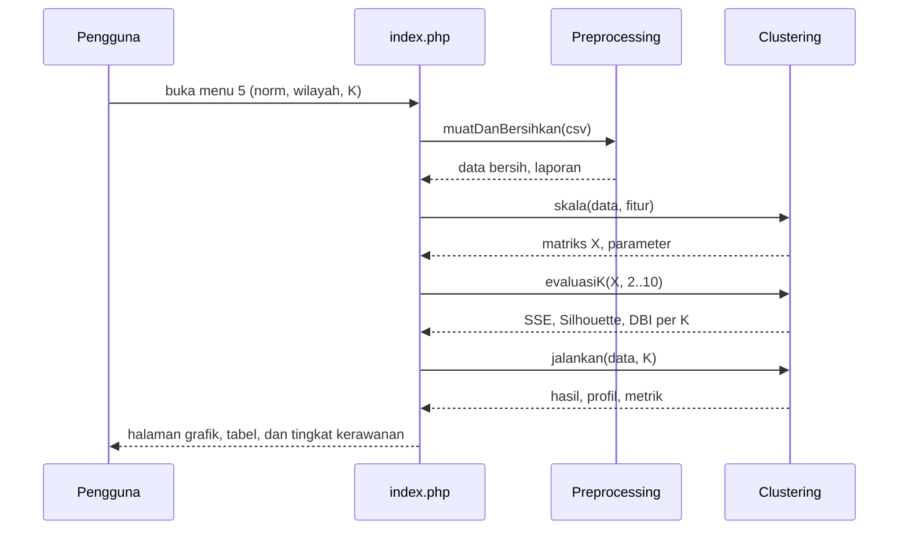
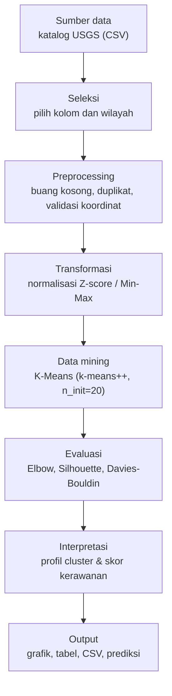

# Laporan Tugas Proyek (Team Base Project) – Penambangan Data
## Sistem Pengelompokan Gempa Bumi Sulawesi dengan K-Means

Dataset: katalog gempa USGS (`query_gempa.csv`, 212 baris, periode 2020–2026).

---

## 1. Pemetaan Soal ke Bagian Laporan

| No | Soal | Bagian laporan | Berkas proyek |
|---|---|---|---|
| 1 | Perancangan proyek akhir data mining, dengan diagram DFD dan UML | Bagian 2 | `dokumen/Laporan_Perancangan_Sistem_Gempa.md` |
| 2 | Arsitektur data mining (alur pipeline) dan penjelasan tiap komponen | Bagian 3 | sama |
| 3 | Algoritma klasifikasi/klastering/regresi dengan RapidMiner, evaluasi, dan laporan | Bagian 5 | Panduan proses RapidMiner (bagian 5) |
| 4 | Algoritma klasifikasi/klastering/regresi dengan Python, evaluasi, dan laporan | Bagian 4 | `main.py`, `app.py`, `src/`, `output/` |

Algoritma yang dipilih untuk poin 3 dan 4 adalah **K-Means (klastering)**. Dataset dan metode dibuat sama agar hasil RapidMiner dan Python dapat dibandingkan.

---

## 2. Perancangan Sistem

### 2.1 Data Flow Diagram (DFD)

**DFD Level 0 (konteks)**



**DFD Level 1**



### 2.2 Diagram Use Case



### 2.3 Diagram Kelas (implementasi PHP)



### 2.4 Diagram Urutan (Sequence) – Menu Clustering



---

## 3. Arsitektur Data Mining (Pipeline)



| Komponen | Fungsi | Implementasi |
|---|---|---|
| Sumber data | Katalog gempa USGS (waktu, lintang, bujur, kedalaman, magnitudo, lokasi) | `query_gempa.csv` |
| Seleksi | Memilih fitur `latitude`, `longitude`, `kedalaman_km`, `magnitudo`; opsi membuang keterangan wilayah "Gorontalo" | `preprocessing.py` / `Preprocessing.php` |
| Preprocessing | Membuang baris kosong dan duplikat (`id`), memvalidasi koordinat (lintang −4…3, bujur 118…126, kedalaman ≥ 0), membuat fitur turunan (tahun, kelas kedalaman, kelas magnitudo, wilayah acuan) | sama |
| Transformasi | Normalisasi agar setiap fitur berskala sama, sehingga kedalaman (ratusan km) tidak mendominasi lintang/bujur (derajat) | `clustering.py` / `Clustering::skala` |
| Data mining | K-Means: membagi data ke K cluster dengan meminimalkan jarak ke centroid | `clustering.py` / `Clustering::kmeans` |
| Evaluasi | Menentukan K: SSE (Elbow), Silhouette (makin tinggi makin baik), Davies-Bouldin (makin rendah makin baik) | `evaluasi_k` / `Clustering::evaluasiK` |
| Interpretasi | Profil tiap cluster dan skor kerawanan = 0,40 × frekuensi + 0,35 × magnitudo rata-rata + 0,25 × proporsi gempa dangkal (ternormalisasi antar cluster) | `profil_cluster` / `Clustering::profil` |
| Output | Grafik PNG/Chart.js, laporan TXT, CSV hasil, halaman prediksi | `output/`, `app.py`, `index.php` |

---

## 4. Implementasi dan Evaluasi dengan Python

**Lokasi:** `sistem_gempa/` (Streamlit `app.py` dan command line `main.py`).

**Menjalankan:**
```bash
pip install -r requirements.txt
python main.py --data query_gempa.csv          # K otomatis (Silhouette tertinggi)
python main.py --data query_gempa.csv --k 4    # K manual
streamlit run app.py                           # versi web
```

**Hasil evaluasi:** tercatat di `output/5_laporan.txt` (tabel evaluasi K, profil cluster, Silhouette, dan DBI). Contoh hasil pada dataset awal `data_mentah.csv` (K = 6):

| Metrik | Nilai |
|---|---|
| Silhouette | 0,3946 |
| Davies-Bouldin | 0,7617 |

Catatan: angka di atas berasal dari dataset awal. Jalankan `main.py` dengan `query_gempa.csv` untuk memperoleh hasil yang sesuai dengan dataset yang dipakai di laporan ini.

---

## 5. Implementasi dan Evaluasi dengan RapidMiner

Proses ini harus dibangun langsung di RapidMiner. Angka hasil bergantung pada versi RapidMiner dan parameter yang dipilih, sehingga tidak dituliskan di sini.

**Langkah proses (urutan operator):**

1. **Read CSV** — file `query_gempa.csv`, pemisah koma, encoding UTF-8. Atur role: `id` sebagai *id*, `place` dan `time` sebagai *attribute* (tidak dipakai clustering).
2. **Filter Examples** (opsional) — buang baris dengan `place` berisi "Gorontalo" jika ingin mengikuti pengaturan Python.
3. **Select Attributes** — pilih hanya `latitude`, `longitude`, `depth`, `mag`.
4. **Normalize** — metode *Z-transformation* (setara dengan Z-score di Python).
5. **k-Means** — `k` = 4 (atau sesuai hasil evaluasi), `max runs` = 20, `max optimization steps` = 100, measure type *EuclideanDistance*.
6. **Cluster Distance Performance** — menghasilkan *Davies-Bouldin Index* dan *Avg. within centroid distance*.
7. **Loop Parameters** (opsional) — ulangi langkah 5–6 untuk `k` = 2…10, lalu catat SSE (within-cluster distance) dan DBI untuk membuat grafik Elbow.

**Yang dilaporkan:** tabel evaluasi untuk tiap K, nilai K yang dipilih dan alasannya, profil tiap cluster (rata-rata lintang, bujur, kedalaman, magnitudo), serta perbandingan dengan hasil Python.

---

## 6. Implementasi Tambahan dengan PHP

Versi PHP (`php/`) mengimplementasikan algoritma yang sama dengan Python: preprocessing, normalisasi, K-Means (k-means++), evaluasi K, dan profil kerawanan. Dijalankan melalui XAMPP di `http://localhost/sistem_gempa/sistem_gempa/php/`. Karena generator acak berbeda, hasil cluster dapat sedikit berbeda dari Python.

---

## 7. Kesimpulan

- Sistem membagi gempa Sulawesi ke dalam cluster berdasarkan lokasi, kedalaman, dan magnitudo.
- K ditentukan dengan tiga metrik (Elbow, Silhouette, Davies-Bouldin), bukan ditebak.
- Tingkat kerawanan cluster dihitung dari frekuensi, magnitudo, dan kedalaman, sehingga hasilnya bisa langsung dibaca untuk mitigasi.
- Keterbatasan: data hanya 212 gempa, fitur tidak mencakup waktu, dan K-Means mengasumsikan cluster berbentuk bulat.
